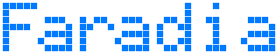
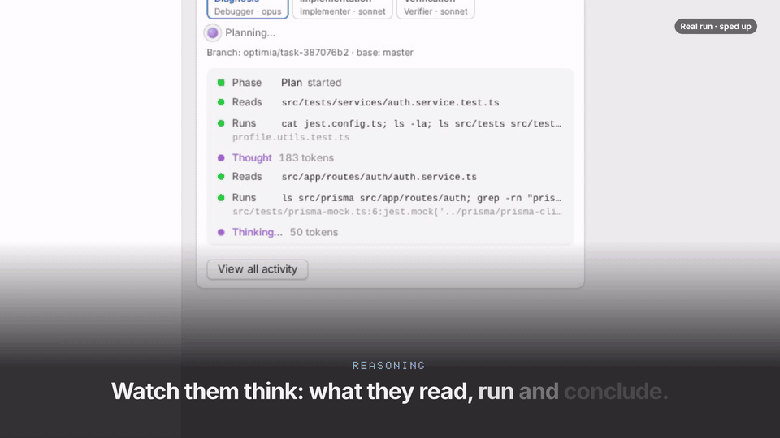
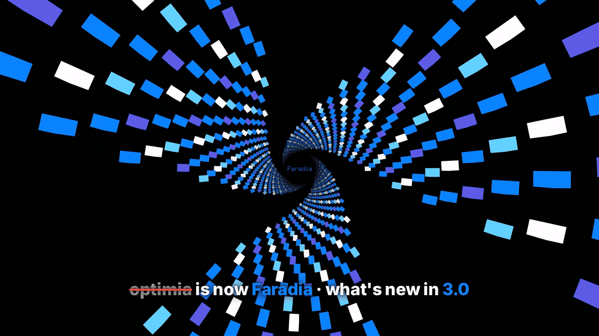
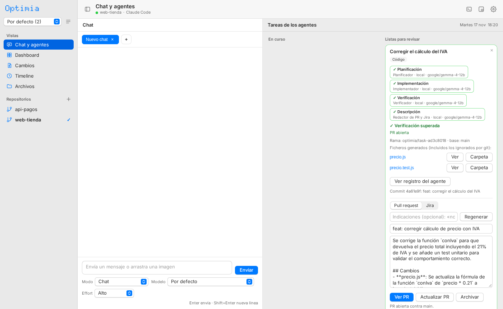
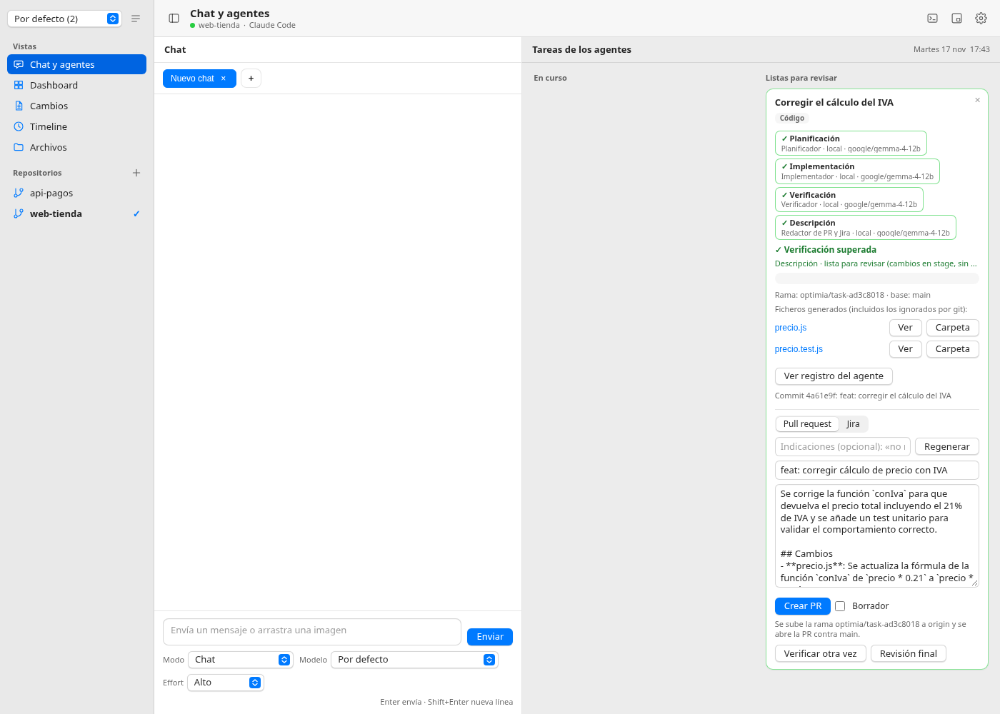
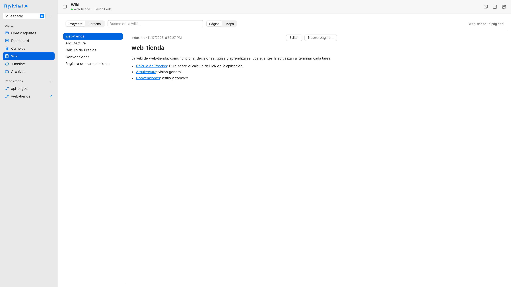
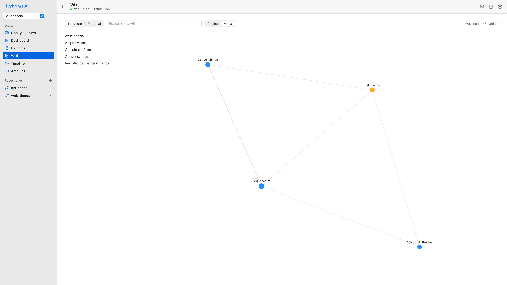
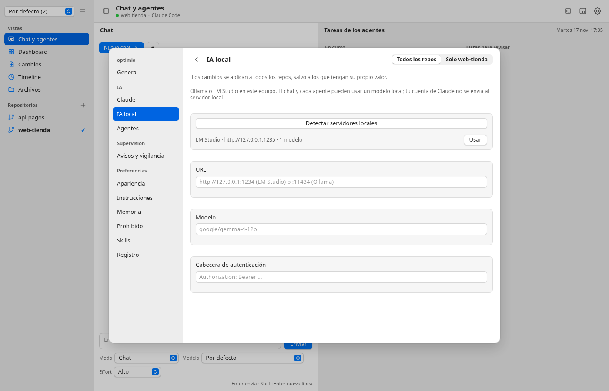

<p align="center">
  
</p>

<p align="center">
  <b>Create quality code by automating your processes. Multiply your productivity without losing the reins of your work.</b><br>
  Direct and supervise AI coding agents across all your repos, from one local web app: Claude Code or local models, your agents and workflows, a wiki that grows with every task.
</p>

> **optimia is now Faradia.** Same app, new name (there were already other things called Optimia).
> Install `faradia`; your settings, agents and repos move over by themselves the first time it runs.
> The `@javilatte/optimia` package keeps getting updates for a few more months and runs Faradia.

<p align="center">
  <a href="https://www.npmjs.com/package/faradia"></a>
</p>

<p align="center">
  <a href="https://www.npmjs.com/package/faradia"></a>
  <a href="https://github.com/javilatte/faradia/actions/workflows/ci.yml"></a>
  <a href="LICENSE"></a>
  
  
</p>

<p align="center">
  <a href="https://optimia.jagoan.es/media/optimia-2.2.0-4k.mp4?v=2"></a>
</p>

<p align="center">
  <a href="https://optimia.jagoan.es/media/optimia-2.2.0-4k.mp4?v=2"><b>▶ Watch Faradia in one minute</b></a>
</p>

<p align="center">
  <a href="https://optimia.jagoan.es/media/faradia-3.0.0-4k.mp4"></a><br>
  <a href="https://optimia.jagoan.es/media/faradia-3.0.0-4k.mp4"><b>▶ optimia is now Faradia: what's new in 3.0</b></a>
  · <a href="https://optimia.jagoan.es/media/optimia-2.3.0-4k.mp4">2.3</a>
</p>



## Why Faradia

- **Agents that finish the job.** Every task runs a pipeline of agents (plan → implement →
  verify) in its own git worktree, with a model per agent. Agents only stop to ask when
  they lack context; anything blocked for safety can be allowed from the card.
- **Trust from checks, not prose.** When an agent gets something wrong, a *Corrección*
  task turns the mistake into a check that fails (architecture, types, lint, a test) and
  proves it on the real mistake. The verification is reviewed as evidence: every command
  the Verifier ran, with its result and its screenshots, and an "OK" the tests contradict
  is not trusted. A comments pass removes the comments that excuse a workaround.
- **A chat that knows its tools.** While you type, Faradia proposes the skill, agent or
  task type that fits (Tab to use it). What needs permission is asked with a card in
  the conversation, never in a terminal; in automatic mode only risky actions ask.
- **Watch them think.** Each card streams what its agent is doing: what it says, the files
  it reads, its edits (+/−), the commands it runs and their results, the tests, how much it
  is thinking. Agents write in the language you wrote the task in.
- **Delivered the way your team works.** Commit, then open the pull request with a
  description drafted from the task, or write the comment for the Jira ticket, which
  may tell more (or less) than the PR. Or keep several tasks on one branch.
- **Knowledge that accumulates.** A wiki per project and a personal one, written from the
  repo in one click and updated by an agent after every task (with your local model when
  there is one), plus each repo's memory. Search it, browse it as a map, export it and
  take it to another machine.
- **Every repo, one window.** Workbenches group your repos; switching is instant, and
  the chat, agents and settings follow. Global settings with per-repo overrides.
- **Batteries included.** The agents, skills and commands of
  [ECC (Everything Claude Code)](https://github.com/affaan-m/ECC) are bundled: faradia's
  own agents follow their best ECC counterpart, and any ECC agent is one `@` away.
- **Local or Claude.** Claude Code, or LM Studio / Ollama models for the chat or for
  any agent; your Claude account never reaches the local server. When Claude runs out
  of usage, the chat and running tasks go on with the local model in the same session
  and come back to Claude when the limit resets.
- **Good habits built in.** Skills for interface work (frontend-craft), plain writing
  (unslop), security reviews (security-audit), plans (plan-optimizer), the simplest
  change that works (ponytail) and pstack's engineering skills (correct, tdd,
  blast-radius, interrogate…) are on for the chat and every agent.
- **Your setup on every computer.** Settings, agents and keys sync through a folder you
  already sync, encrypted with a passphrase only you know.
- **Safe by default.** Agents run in Claude Code's OS sandbox, can never commit, push
  or merge, and a policy hook blocks destructive commands, with exceptions you approve.
- **Live supervision.** Dashboard, live diffs, timeline, signals (large deletes,
  secrets, sensitive files), notifications and a compact glance window.

## Screenshots

<table>
  <tr>
    <td width="50%"><br><sub><b>Delivery</b> — the PR title and description, drafted from the task</sub></td>
    <td width="50%"><br><sub><b>Wiki</b> — pages written by the agents, with backlinks</sub></td>
  </tr>
  <tr>
    <td width="50%"><br><sub><b>Wiki map</b> — how the pages link to each other</sub></td>
    <td width="50%"><br><sub><b>Local AI</b> — LM Studio and Ollama, detected in one click</sub></td>
  </tr>
</table>

## Quick start

```
npm install -g faradia
cd your-project
faradia
```

```
faradia running at http://127.0.0.1:54213/?token=… (project: /path/to/your-project)
```

No terminal wizard: models, agents, local AI, instructions, memory, permission rules,
skills, signals and watchlists are all configured in the web UI.

---

## Installation

```bash
npm install -g faradia
```

If you get a permission error (common on Linux with system Node), install to your user prefix instead:

```bash
npm install -g faradia --prefix ~/.local
```

Make sure `~/.local/bin` is in your `PATH` (`echo 'export PATH="$HOME/.local/bin:$PATH"' >> ~/.bashrc`).

Or run without installing:

```bash
npx faradia
```

---

## Requirements

| Tool | Required | Purpose |
|---|---|---|
| `node` ≥ 22 | yes | runs the server and the CLI launcher |
| `git` | yes | worktrees for agent tasks, and all repo supervision |
| [`claude`](https://claude.ai/code) (Claude Code CLI) | yes | chats and agents are real `claude` subprocesses — Faradia never calls the Anthropic API directly |
| [LM Studio](https://lmstudio.ai) ≥ 0.4 or [Ollama](https://ollama.com) ≥ 0.14 | optional | local models for the chat or for any agent (both serve the Anthropic Messages API that `claude` needs) |
| [`gh`](https://cli.github.com) | optional | opens the pull request of a task from its card (without it, Faradia pushes the branch and opens the page to create it) |
| `bubblewrap` and `socat` (Linux) | recommended | Claude Code's OS sandbox for the agents (`sudo apt install bubblewrap socat`); built in on macOS. Without it agents do not start unless you turn the sandbox off in Settings → General |
| [`gitleaks`](https://github.com/gitleaks/gitleaks) | optional | extra secret detection rules on top of the built-in ones |

---

## The views

| View | What it does |
|---|---|
| **Chat & agents** | Chat with Claude (with attachments, `@agent` and `/skill`) and the board of agent tasks for the selected repo. |
| **Dashboard** | One card per repo of the active workbench: branch, ahead/behind, changes, lines ±, last commit, live activity (including agents in their worktrees), 24 h activity and recent signals. |
| **Changes** | Live diff of any repo or task worktree: inline or side by side, with context or the whole file, syntax highlighting and a change map. It refreshes by itself while files change. Commits open here too. |
| **Wiki** | The project's wiki and your personal one: tree, search, link map, reading and editing. |
| **Timeline** | Chronological feed of changed files, commits, branch switches, watchlist events, agent task updates, signals and orphaned changes, with filters and the commit history of each repo. |
| **Files** | File tree with previews (markdown, code, images, audio, video, PDF), copy path, a file clipboard, rename/copy/move/delete with **Undo**, and a trash you can restore from. |

The **glance** button in the top bar opens a small window with one line per repo,
for a corner of your screen.

---

## Agents and pipelines

Every task runs as a pipeline of stages, each one handled by an agent in the task's
own git worktree:

| Task type | Pipeline |
|---|---|
| Code (`coding`) | plan → implement → comments → verify |
| Bug (`bugfix`) | diagnose → implement → comments → verify |
| Tests (`tests`) | plan → write tests → comments → verify |
| Correction (`correction`) | correct → verify |
| Verification kit (`verification-kit`) | the repo's verify skill and feature map |
| Documentation (`documentation`) | research → (choose format and target) → write |
| Audit (`audit`) | audit → report (no changes) |
| Agente propio (`custom`) | one stage with one of your agents |

Review, commit preparation and the PR / Jira description run on demand once a task
is ready. The verifier runs
the project's tests, lint and build and gives a verdict; disable it to skip that
stage. Each task card shows which agent and model ran every stage.

**Faces.** Each agent has a face on its task cards, made with
[BoopFace](https://github.com/CX-ArtLab/BoopFace) (MIT, bundled in `web/vendor/boopface`):
it waits while the agent works, scans while it verifies or reviews, looks wary when it
asks you something, smiles when the work is ready and droops when it fails. Choose
another face in Settings → Agentes (click the face); turn them all off in Settings →
Apariencia.

### Checks and evidence (pstack)

Inspired by Lauren Tan's talk *Turn slop into gold* and her plugin
[pstack](https://github.com/cursor/plugins/tree/main/pstack) (MIT): you trust agents
because the repo stops them and their work comes with evidence, not because the
instructions grow.

- **Corrections.** A *Corrección* task follows pstack's `correct` skill for one mistake:
  it picks the highest level that works (architecture, types, a lint rule whose message
  names the fix, a test; docs only for judgment calls), runs the check against the real
  past mistake to show it fails, and adds the rule to a rule ↔ enforcer table in the
  repo's `CLAUDE.md` or `AGENTS.md`. Start one from the mode selector, from a suggestion
  ("no vuelvas a…"), with *Evitar que se repita…* on a finished task, or from a proposal
  of the comments pass. The card shows the level of the check it added.
- **Evidence.** Faradia records every command the Verifier runs and its result, from the
  session's stream, plus the screenshots or videos it saves in
  `.faradia/evidence/<task>/` (outside the worktree, never committed). The card lists
  them. A verdict of "OK" with no command run, or with a test, lint or build command
  that failed last, becomes *unverified*.
- **Comments pass.** Comment Sicko removes the comments the task added to narrate code or
  excuse a workaround, never the ones that were already there, and turns each constraint
  a comment defended into a proposal you can make a correction of. Turn its agent off to
  skip the stage.
- **Principles.** Each agent works with the pstack principles of its stage and names the
  one that changed a decision. Choose them per agent, or turn them off, in Settings →
  Agents.
- **Verification kit.** A task that follows `create-verification-skill` to give the repo
  a scripted way to drive the real app, with a feature map; the Verifier uses it.

pstack's skills that work in Claude Code are built in for the chat and every agent:
`correct`, `tdd`, `blast-radius`, `interrogate`, `arena`, `architect`, `how`, `why`,
`in-your-own-words`, `no-comments`, `benchmark-checklist`, `create-verification-skill`
and `maintain-verification-skill` (`scripts/vendor-pstack.sh` updates them).

In **Settings → Agents** you can change any agent's engine (Claude or local), model,
effort and role prompt, choose which agent runs each stage, and create your own
agents — for this project or for all of them. Agents are plain Markdown files with
frontmatter:

```
<project>/.faradia/agents/<id>.md      this project only (wins)
~/.config/faradia/agents/<id>.md       every project
```

### Local models

**Settings → Local AI → Detect local servers** finds LM Studio and Ollama on
this machine and lists their models; the chat's model selector lists them too,
under the Claude models. Any agent can use a local model, and several agents can use
different ones at the same time. Your Claude account never reaches the local server:
local sessions get a placeholder token, `ANTHROPIC_API_KEY` is dropped and background
requests use the same local model. Tested end to end with LM Studio and Gemma 4 12B
(plan → implement → verify, repo study, PR and Jira descriptions).

Agents work with as little intervention as possible: they stop only to ask for missing
details, and a failed stage is retried once by itself. They can never commit, push,
merge or rebase, and destructive commands are blocked by a policy hook (see
[Security](#security)): the agent is told why and carries on; the card lists what was
blocked and lets you allow it. Read-only stages cannot edit files. Task
agents only see faradia's MCP server and your repo's `.mcp.json`, not the
connectors of your claude.ai account.

Commit and delivery are always your action, from the task card. "Suggest commit
message" fills in a Conventional Commits message in the repo's language; the commit
respects `.gitignore` (ignored files only go in if you tick them).

After the commit, a repo with a remote delivers the task as a **pull request**:

- **Pull request** tab: "Draft with AI" drafts the title and description from the
  request, the plan, the verification and the branch diff. It follows the repo's PR
  template and leaves the internal process of the task out. Optional notes steer it
  ("don't mention the migration"). "Create PR" pushes the branch and opens the PR with
  `gh` (draft if you want); later commits update it. Without `gh`, or on GitLab and
  Bitbucket, the branch is pushed and the page to create the PR opens.
- **Jira** tab: a separate comment for the ticket (what was done, how to test it,
  what is pending), which can say more or less than the PR. "Copiar" puts it on the
  clipboard.

A repo without a remote merges the task locally instead (fast-forward when it can),
then removes the task's worktree and branch.

---

## One workflow, every repo

Configuration has two layers, so every repo works the same way and each one can
still have what is its own. Settings has a **All repos / Only this repo**
switch:

| | All repos (global) | This repo |
|---|---|---|
| Model, effort, local AI | the default for every repo | only what this repo changes; each field says whether it is inherited, with **Reset** and **Use in every repo** |
| Instructions | the common workflow (commit style, how to verify, language…) | extra instructions, added after the global ones and winning on conflict |
| Forbidden (no-go) | denied for every repo | added on top of the global list |
| Agents and pipelines | which agent and model runs each stage | per-repo overrides |
| Memory | — | the repo's own knowledge: commands, structure, conventions, pitfalls |
| Appearance, signals | global | — |

**Learn this repo** (Settings → Memory, or the empty board of a new repo) runs a
read-only agent that studies the repo and proposes its memory; you save it with one
click and can edit it later. Quick changes from the composer (model, effort) are
stored where the value lives: in the repo if it overrides it, otherwise for all repos.

Settings saved by older versions (a full copy in every repo) are migrated on first
read: only what differs from the defaults stays as a repo override.

### Your configuration file

**Settings → General → Export configuration…** saves everything global in one
JSON file: settings, common instructions and no-go list, global agents, the stage
map and signal preferences. It leaves out your repos, their memory and anything
tied to this machine; the local AI auth header only goes in if you tick it. Keep
the file somewhere private — it holds your instructions and your agents' prompts.

To import it, **drop it anywhere on the Faradia window** (or use Import
configuration…). Faradia shows what will change and backs up the current
configuration to `~/.config/faradia/backups/` first. On a fresh install, the
welcome sheet offers exactly that.

### Sync between computers

**Settings → Sync** keeps your global configuration the same on every computer: settings,
AI keys, agents, stage map, instructions and notices. Pick a folder you already sync
(Google Drive for desktop, Dropbox, iCloud, Syncthing…) and a passphrase; do the same on
the other computers. The copy is encrypted on each computer (scrypt + AES-256-GCM) before
it is written, so whoever stores the folder cannot read it. Changes travel a few seconds
after you make them and every few minutes; if two computers change at once, the newest
wins and the other is kept in `~/.config/faradia/backups/`. Turning it off can delete the
copy too. Repos, workbenches and tasks stay on each computer.

### Updates

Faradia asks the npm registry at most once a day whether a newer version exists and
shows a notice in the toolbar with the install command and the release notes. Turn
it off in Settings → General, or with `FARADIA_NO_UPDATE_CHECK=1`. After an update, a
short optional tour shows what changed (Settings → General → What's new… shows it again).

### Problem report

Warnings and errors from every repo and from the page itself are grouped by kind in
**Settings → Log → Problems found**, without keys, home paths or message text, together
with how chat suggestions were received. Nothing leaves your computer; **Export report…**
writes a file you can attach to an issue.

## Delivering tasks

After the agents finish, you review and commit from the card. In a repo with a remote:

- **Pull request**: "Draft with AI" drafts the title and description from the request,
  the plan, the verification and the branch diff, following the repo's PR template and
  leaving the task's internal process out. Optional notes steer it. "Create PR" pushes the
  branch and opens the PR with `gh` (draft if you want); later commits update it. Without
  `gh`, or on GitLab and Bitbucket, the branch is pushed and the page to open it shows up.
- **Jira**: a separate comment for the ticket (what was done, how to test it, what is
  pending), copied to the clipboard.
- **Merge**: the commit is merged into the base branch locally, also in a repo with a remote.
- **Leave it on its branch**: the task ends with its commit. Type an existing branch in
  the task's "Branch" field and the next task continues it: several tasks, one branch.

The pull request can be drafted before the commit. Finished tasks go to the **Archive**
(the button on the agents board): what was asked, how it ended, which agents and models
ran it and their report, with search. Entries are deleted after 30, 15, 7 or 1 days, or
kept forever, as chosen at the bottom of the archive.

## Wiki and knowledge

The **Wiki** view has two wikis: the project's and your personal one. Pages are markdown
linked with `[[Page]]`; browse them as a tree, search them, see them as a map, read and
edit them. After each committed task (and each report), the *Librarian* agent updates
the project wiki, and your personal wiki when it learns something general. It uses your
local model when one is configured and answering; otherwise, or if it fails, Claude Haiku.

With [CodeGraph](https://github.com/colbymchenry/codegraph) on, the project wiki also has a
**code map** (*Mapa del código*) that Faradia takes from CodeGraph's index without any model:
the pieces used from the most other files and which area depends on which. It is refreshed
after every task, and *Conocer este repo* and the wiki agent start from it.

Wikis live outside the repos (`~/.local/share/faradia/knowledge`), keyed by the project's
git remote, so a project has the same wiki on every machine. **Settings → General →
Export knowledge** writes one file with your configuration, every wiki and each repo's
memory; importing it merges by date (the newer side wins, replaced items are backed up).

## ECC

[ECC (Everything Claude Code)](https://github.com/affaan-m/ECC), MIT, is bundled in
`vendor/ecc` (not installed as a Claude Code plugin):

- faradia's agents follow the method of their ECC counterpart (Reviewer ← code-reviewer,
  Planner ← planner + architect, Verifier ← build-error-resolver, Test writer ←
  tdd-guide, Auditor ← security-reviewer + performance-optimizer…);
- its 72 agents are in Settings → Agents; type `@` in the chat to call any of them;
- its skills (a general-purpose set by default, any of the 327 selectable in Settings →
  General) and, optionally, its commands reach every session.

## Attachments

Drop, paste or attach any file in the chat. Images go as images; PDFs are referenced by
path and page count so Claude reads only the pages it needs; Word, Excel, PowerPoint and
ODT text is extracted to markdown; small text files go inline; anything else by path.

## Dictation

Click the microphone next to the message box and speak: the text appears in the box, where
you review it before sending (Esc cancels). It is transcribed on your computer, outside the
browser, with no accounts, APIs or payments:

- **macOS**: the system's own speech recognition, offline. A small Swift helper
  (`server/voice/apple/`) comes built in the npm package; macOS asks for permission once.
- **Linux and Windows**, or when macOS cannot: Whisper, run natively on every core by
  Faradia. It installs itself the first time (about 110 MB, in `~/.local/share/faradia/voice`)
  while the browser transcribes that dictation. It uses large-v3-turbo with 8 threads or more
  and small with fewer, and chooses between Spanish and English by itself.

Settings → Dictado changes the engine (Faradia, Whisper or the browser), the model and the
language.

## Supervision

Supervision is **read-only**: Faradia never writes to a repo to monitor it.

- **Plane 1** — git state from `git status --porcelain=v2`, refreshed when files or
  `HEAD` change.
- **Plane 2** — a per-repo **watchlist** of patterns (`.gitignore` syntax) that are
  reported even when git ignores them: `.env`, keys, build output…
- **Signals** — passive, never blocking:
  - large deletes (lines or files at once),
  - sensitive files (marked as exposed when git would commit them),
  - possible secrets in files git would commit (built-in rules plus gitleaks if
    installed; the secret value is never stored or shown),
  - test changes, especially by an agent.
- **Orphaned changes** — uncommitted work left untouched for a while (30 min by
  default).

Thresholds, rules, notifications and the watchlist live in
**Settings → Signals and watchlist**. Folders are watched one by one (not with a
recursive watch that would put a watcher on every `node_modules` folder).

---

## Security

The server listens on `127.0.0.1` only, and every API and WebSocket request must
pass three checks:

1. the `Host` header must be loopback with the real port (blocks DNS rebinding),
2. the `Origin`, when present, must be Faradia itself (blocks CSRF),
3. a per-run token, sent as `X-Faradia-Token` or as a `SameSite=Strict` cookie set
   by the link Faradia prints on start.

Agents are contained in layers:

- **OS sandbox** (Claude Code's: bubblewrap on Linux, Seatbelt on macOS): Bash can only
  write inside the task's worktree. Required by default (`failIfUnavailable`).
- **Policy hook**: destructive commands (`rm`, `sudo`, `git reset --hard`, discarding
  changes…) are blocked anywhere in a command line, the agent is told why and carries on.
  The card lists them and "Allow" approves that exact command for the repo. Approvals
  are fixed when a stage starts, so an agent cannot grant itself one; if the hook cannot
  run, plain deny rules take its place.
- **Never approvable**: commit, push, merge and rebase (deny rules plus a git hook).
- **Network**: from their sandbox, agents reach package registries only (npm, Yarn, PyPI,
  crates.io, Go, RubyGems, Maven), so they can install dependencies; turn it off in
  Settings → General. Files an agent created in its worktree it may delete; tracked files
  stay protected.
- **Chat permissions**: in automatic mode (the default) Claude Code approves what is safe
  and the rest is asked with a card in the chat (Allow, Always allow in this repo, Deny);
  in "ask" mode every action that needs permission is asked.
- Local-model sessions never receive your Claude credentials.

File operations stay inside the repo (no absolute paths, `..`, or symlinks pointing
out), never touch `.git` or `.faradia`, never overwrite, and raw files are served
with a sandbox CSP.

---

## Where state lives

```
<project>/.faradia/              per project (excluded from git automatically)
├── settings.json                only what this repo changes, its own instructions and no-go list
├── claude-settings*.json        permissions for faradia's own claude sessions (--settings)
├── memory.md                    the repo's knowledge, included in every session's system prompt
├── tasks.json, chats.json       kanban and chat state
├── tasks-archive.json           finished tasks (Archive)
├── agents/                      project agents and stage map
├── evidence/<task>/             what the Verifier ran, with its results and captures
└── logs/faradia.log             activity log (Settings → Log)

~/.config/faradia/               global
├── settings.json                appearance, model/effort, local AI, common instructions and no-go list
├── workbenches.json             workbenches and their repos
├── agents/                      agents for every project
├── watchlists.json              plane 2 patterns per repo
├── preferences.json             signals, thresholds, notifications
├── sync.json                    sync folder and passphrase (readable only by you)
└── backups/                     configuration before each import or sync conflict

~/.local/share/faradia/
├── worktrees/<repo>/<task>/     one git worktree per agent task, outside the repo
├── voice/                       dictation engine (Whisper) and its models, installed on first use
├── timeline/events.jsonl        the timeline
├── issues.jsonl                 problem report
└── trash/                       files deleted from the explorer
```

Faradia leaves your repo alone: `.faradia` is excluded through `.git/info/exclude`
(never your `.gitignore`), its JSON is written the way Prettier formats it (with your
print width), so `prettier --check .` stays green, and the task worktrees live outside
the repo, where your linters, test runners and watchers do not see them; and the Claude Code permissions of its own sessions —
including the "Forbidden" list — live in `.faradia/claude-settings*.json` and are
passed with `claude --settings`, so your project's `.claude/` is never touched.

---

## CLI

```
faradia              Set up .faradia/, start the server, open the browser
faradia --port 4777  Use a fixed port (default: a free one); also FARADIA_PORT
faradia --version    Print version
faradia --help       Print help
```

`FARADIA_NO_OPEN=1` starts the server without opening a browser (handy over SSH).

Keyboard: ⌥1…⌥5 (Alt on Linux and Windows) switch views, ⌘, (Ctrl+,) opens
Settings and ⌃⌘S (Ctrl+Alt+S) shows or hides the sidebar.

---

## Development

```bash
npm ci
npm run lint            # ESLint
npm run format:check    # Prettier
npm run test:unit       # node --test
npm run test:bats       # launcher and HTTP integration tests
npx playwright install chromium
npm run test:e2e        # Playwright, against a fake `claude` CLI
```

The design is described in [docs/design.md](docs/design.md) and what comes next in
[docs/roadmap.md](docs/roadmap.md).

### Releasing

1. Bump `version` in `package.json`, add the entry to `CHANGELOG.md` and merge to `main`.
2. Tag it and create the GitHub release: `git tag -a vX.Y.Z -m "faradia X.Y.Z" && git push origin vX.Y.Z`,
   then `gh release create vX.Y.Z --title "faradia X.Y.Z" --notes-file <notes>`.
3. Publishing the release runs `.github/workflows/publish.yml`, which checks that the tag
   matches `package.json`, runs lint and tests and publishes to npm with Trusted Publishing
   (no npm token; the package gets a provenance attestation). To publish an existing tag by
   hand: `gh workflow run publish.yml -f tag=vX.Y.Z`.

---

## License

MIT
